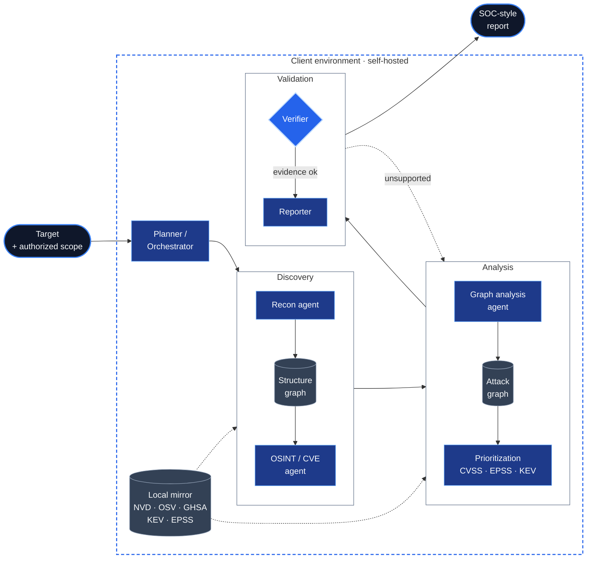
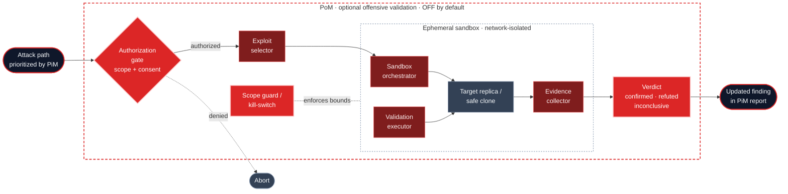
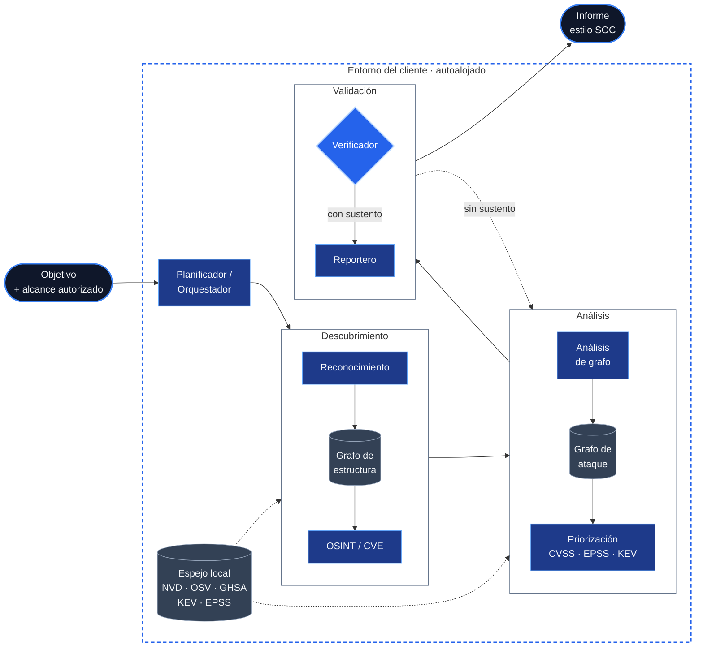
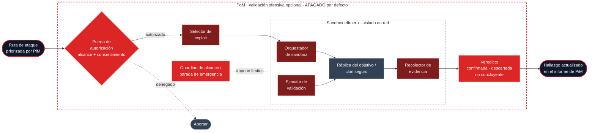

<picture>
  <source media="(prefers-color-scheme: dark)" srcset="assets/logo-dark.svg">
  <source media="(prefers-color-scheme: light)" srcset="assets/logo-light.svg">
  
</picture>

 
 

**Self-hosted vulnerability assessment, powered by specialized AI agents.**
 
Maps the attack surface, cross-references it with known vulnerabilities and delivers a SOC-style report — without attacking anything and without your data leaving your environment.

 

[Overview](#what-is-pim) ·
[Architecture](#multi-agent-architecture) ·
[PoM](#pom--offensive-validation-optional) ·
[Methodologies](#methodologies) ·
[Roadmap](#roadmap) ·
[Responsible use](#responsible-use) ·
**[Versión en español](#versión-en-español)**

---

## What is PiM

**PiM (Potential-vulnerability Intelligence Mapper)** is a platform that an
organization installs on its own infrastructure to **assess the potential
vulnerabilities** of its systems and software projects.

A team of AI agents, each with a narrowly scoped task, analyzes the structure of
the target, cross-references it with known vulnerability databases, builds the
possible attack paths, and produces a **SOC-style report** in which every
finding is mapped to a standard methodology (MITRE ATT&CK, CWE/CAPEC or OWASP).

> [!IMPORTANT]
> PiM performs **vulnerability assessment**, not penetration testing. It does
> not run exploits, it does not modify systems, and it does not send data
> outside your environment unless you configure it to.

### Why PiM?

| Problem | How PiM addresses it |
|---|---|
| Manual penetration testing is expensive and slow | Automates reconnaissance, CVE matching and prioritization |
| Offensive tools run real exploits (legal and operational risk) | Read and report only: **passive** analysis |
| Uploading your vulnerability map to a third-party cloud is unacceptable | **100% self-hosted**, with locally mirrored vulnerability databases and optional local AI |
| Automated reports don't say what was left unchecked | Measures **coverage** against the methodology: what was reviewed and what was not |

---

## Principles

- **Analyze and report only.** Never attacks, exploits or modifies the target.
- **Your data stays home.** Vulnerability databases are queried offline; the only
  data that may leave is what you choose to send to a cloud model.
- **Structured sources, never open web search.** CVEs come from official
  databases, not from a model that may invent them.
- **Every finding is backed by evidence.** A verifier agent reviews the evidence
  before anything reaches the report.
- **No vendor lock-in.** The AI model is a swappable component.

---

## Multi-agent architecture

No single agent analyzes everything: each one works with a focused context,
which reduces overload and errors.

Solid lines: workflow · dotted lines: data lookups and feedback · the dashed blue border marks everything that never leaves the client environment.

| Agent | Responsibility |
|---|---|
| **Planner / Orchestrator** | Turns the objective into techniques to review and distributes the work |
| **Reconnaissance** | Identifies technologies, versions, dependencies and entry points; builds the structure graph |
| **OSINT / CVE** | Matches each technology and version against vulnerability databases (software composition analysis) |
| **Graph analysis** | Combines structure and vulnerabilities to build the attack graph |
| **Prioritization** | Ranks findings using CVSS, EPSS and CISA KEV |
| **Verifier** | Confirms every finding is supported and reduces false positives |
| **Reporter** | Produces the SOC-style report mapped to the methodology |

### The two graphs

| | Structure graph | Attack graph |
|---|---|---|
| **Answers** | How is it built? | How would an attacker move? |
| **Nodes** | Components, services, dependencies, endpoints | States gained by the attacker (access, privileges) |
| **Edges** | Who talks to whom | Actions between states, labeled with their technique (ATT&CK / CAPEC) |
| **Output** | Attack surface | Chained attack paths |

The structure graph is built first; the attack graph is built on top of it.

---

## Methodologies

| What is being assessed | Methodology |
|---|---|
| Attack behavior in an environment or system | [MITRE ATT&CK](https://attack.mitre.org) |
| Linear explanation for non-technical audiences | Cyber Kill Chain |
| Flaws in a specific piece of software | [CWE](https://cwe.mitre.org) + [CAPEC](https://capec.mitre.org) |
| Web applications | [OWASP](https://owasp.org) Testing Guide / Top 10 |

Every finding and every attack path is tagged with its technique, and the report
shows the **coverage** of the assessment.

---

## Vulnerability sources

All of them are downloaded and queried as a **local mirror**, so nothing about
your stack goes out to the internet.

| Source | Use |
|---|---|
| [NVD / CVE](https://nvd.nist.gov) | Reference database |
| [OSV.dev](https://osv.dev) | Lookup by exact package and version |
| GitHub Security Advisories | Code dependencies |
| CISA KEV | Vulnerabilities known to be actively exploited |
| [EPSS](https://www.first.org/epss) + CVSS | Exploitation probability and severity |

> [!NOTE]
> Matching versions to CVEs naturally produces false positives. Reducing them
> (verifier + evidence for every finding) is a core part of the project.

---

## AI models

PiM talks to models through a **common interface**; each organization plugs in
the one it prefers at deployment time.

| Mode | Advantage | Trade-off |
|---|---|---|
| **Cloud** (your own Anthropic, OpenAI, etc. key) | Best reasoning | Data travels to a third party |
| **Local** (e.g. Ollama) | Nothing leaves the environment | Requires hardware; lower quality |
| **Hybrid** | Heavy reasoning in the cloud with abstracted data | Protects less than it seems; not suitable for highly sensitive environments |

To compensate for weaker local models:

- **Model per agent:** the strongest model for the planner and the verifier; a lightweight one for the collection agents.
- **Failover and rotation:** an ordered list of fallback models in case of errors or rate limits.
- **Documented requirements:** recommended local models and the hardware they need.

---

## Final report

- Findings classified by methodology technique.
- Evidence and score for every finding (CVSS / EPSS / KEV).
- Attack paths visualized on the graph.
- Coverage: which tactics and techniques were reviewed and which were not.

---

## PoM — offensive validation (optional)

<picture>
  <source media="(prefers-color-scheme: dark)" srcset="assets/pom-logo-dark.svg">
  <source media="(prefers-color-scheme: light)" srcset="assets/pom-logo-light.svg">
  
</picture>

> [!WARNING]
> **PoM is OFF by default and must be enabled consciously.** While PiM only
> analyzes, PoM actually runs offensive tools to confirm whether a vulnerability
> is real. That crosses from *vulnerability assessment* into *penetration
> testing*, so it carries a heavier legal weight (in Peru, Law No. 30096) and
> requires explicit, scoped authorization for every target.

**PoM (Proven-vulnerability Offensive Mapper)** is a module inside PiM. It takes
the attack paths that PiM has already mapped and prioritized, and tries to
actually walk them — safely and in isolation — to separate real vulnerabilities
from false positives. A potential finding becomes **confirmed**, **refuted** or
**inconclusive**.

> PoM is designed to grow into a standalone program later. For now it lives as
> an opt-in module within PiM.

### How PoM works

Everything happens inside **ephemeral, network-isolated sandboxes**: nothing is
run against the live production system. PoM provisions a disposable environment,
replays the validation there, collects the evidence, and tears it down.

Red dashed border: the whole module, off by default · gray dashed border: the isolated sandbox · the authorization gate blocks everything until scope and consent are verified.

| Component | Responsibility |
|---|---|
| **Authorization gate** | Verifies explicit, scoped authorization and consent before anything runs; denies and aborts otherwise |
| **Exploit selector** | Maps each prioritized PiM attack path to a safe validation module or proof-of-concept |
| **Sandbox orchestrator** | Provisions an ephemeral, network-isolated environment and a replica/safe clone of the target |
| **Validation executor** | Runs the offensive check *inside the sandbox only*, never against production |
| **Evidence collector** | Captures proof of success or failure for each attempt |
| **Verdict** | Marks the finding confirmed, refuted or inconclusive and feeds it back to the PiM report |
| **Scope guard / kill-switch** | Enforces the authorized boundaries and aborts immediately if anything goes out of scope |

### Design principles for PoM

- **Opt-in and off by default.** PiM never runs offensive actions unless the operator enables PoM for a specific, authorized scope.
- **Sandboxed, never against production.** Validation runs on a replica or clone inside an isolated environment with no path to the live target.
- **Fail-closed.** If authorization, scope or the sandbox cannot be guaranteed, PoM does not run.
- **Reversible and auditable.** Every run is logged, scoped and disposable; the sandbox is destroyed afterward.

---

## Deployment and security

- Self-hosted in the organization's own environment.
- Interface bound to `localhost` by default.
- Keys and secrets encrypted at rest; the encryption key is backed up separately.

---

## Roadmap

PiM is in the **design phase**. There are no installation instructions yet.

- [ ] Define the approach: white box (with source code) or black box
- [ ] Define the main methodology for each type of target
- [ ] Choose the language and implementation stack
- [ ] Define the license model
- [ ] Set up a safe test environment (DVWA, OWASP Juice Shop)
- [ ] Prototype the reconnaissance agent and the structure graph
- [ ] Local mirror of NVD / OSV / KEV / EPSS
- [ ] First end-to-end SOC-style report

---

## Responsible use

PiM is a **defensive** tool, but it must only be used on systems you own or with
the **explicit authorization** of their owner. Scanning third-party systems
without permission may be a crime (in Peru, Law No. 30096 on Computer Crimes,
and equivalent laws in other countries). The authors are not responsible for
unauthorized use.

---

## About the name

**PiM** stands for *Potential-vulnerability Intelligence Mapper*: it maps
**potential** vulnerabilities (not confirmed by exploitation) with the help of
artificial **intelligence** agents.

The name also nods to Quechua: *pi* means "who?", and the suffix *-m* marks a
statement backed by direct evidence. Those are the two ideas behind the tool:
asking **who** could get in, and **backing** every finding with evidence.

---

## Author

**Miguel Angel Llusca Surco** · [LinkedIn](https://www.linkedin.com/in/miguel-angel-llusca-surco/)

## Contributing

The project is at an early stage. Ideas, architecture reviews and issues are welcome.

## License

To be defined.

 

---
---

## Versión en español

[Back to English](#what-is-pim)

### Qué es PiM

**PiM (Potential-vulnerability Intelligence Mapper)** es una plataforma que una
organización instala en su propia infraestructura para **evaluar las
vulnerabilidades potenciales** de sus sistemas y proyectos de software.

Un equipo de agentes de IA, cada uno con una tarea acotada, analiza la estructura
del objetivo, la cruza con bases de vulnerabilidades conocidas, construye las
posibles rutas de ataque y genera un **informe estilo SOC** en el que cada
hallazgo queda mapeado a una metodología estándar (MITRE ATT&CK, CWE/CAPEC u
OWASP).

> [!IMPORTANT]
> PiM hace **evaluación de vulnerabilidades**, no *penetration testing*. No
> ejecuta exploits, no modifica sistemas y no envía datos fuera de tu entorno
> salvo que tú lo configures.

#### ¿Por qué PiM?

| Problema | Cómo lo aborda PiM |
|---|---|
| El pentesting manual es caro y lento | Automatiza el reconocimiento, el cruce con CVEs y la priorización |
| Las herramientas ofensivas ejecutan exploits reales (riesgo legal y operativo) | Solo lee y reporta: análisis **pasivo** |
| Subir tu mapa de vulnerabilidades a una nube de terceros es inaceptable | **100 % autoalojado**, con bases de vulnerabilidades en espejo local e IA local opcional |
| Los reportes automáticos no dicen qué quedó sin revisar | Mide la **cobertura** contra la metodología: qué se revisó y qué no |

### Principios

- **Solo analiza y reporta.** Nunca ataca, explota ni modifica el objetivo.
- **Tus datos no salen.** Las bases de vulnerabilidades se consultan offline; el
  único dato que puede salir es el que tú decidas enviar a un modelo en la nube.
- **Fuentes estructuradas, nunca búsqueda web libre.** Los CVE vienen de bases
  oficiales, no de un modelo que puede inventarlos.
- **Cada hallazgo con sustento.** Un agente verificador revisa la evidencia antes
  de que algo llegue al informe.
- **Sin dependencia de proveedor.** El modelo de IA es una pieza intercambiable.

### Arquitectura multiagente

Ningún agente analiza todo: cada uno trabaja con un contexto enfocado, lo que
reduce la sobrecarga y los errores.

Línea continua: flujo de trabajo · línea punteada: consulta de datos y retroalimentación · el borde azul punteado marca lo que nunca sale del entorno del cliente.

| Agente | Responsabilidad |
|---|---|
| **Planificador / Orquestador** | Traduce el objetivo en técnicas a revisar y reparte el trabajo |
| **Reconocimiento** | Identifica tecnologías, versiones, dependencias y puntos de entrada; construye el grafo de estructura |
| **OSINT / CVE** | Cruza cada tecnología y versión con las bases de vulnerabilidades (análisis de composición de software) |
| **Análisis de grafo** | Combina estructura y vulnerabilidades para construir el grafo de ataque |
| **Priorización** | Ordena los hallazgos según CVSS, EPSS y CISA KEV |
| **Verificador** | Confirma que cada hallazgo tenga sustento y reduce falsos positivos |
| **Reportero** | Genera el informe estilo SOC mapeado a la metodología |

#### Los dos grafos

| | Grafo de estructura | Grafo de ataque |
|---|---|---|
| **Responde a** | ¿Cómo está construido? | ¿Cómo se movería un atacante? |
| **Nodos** | Componentes, servicios, dependencias, endpoints | Estados que gana el atacante (acceso, privilegios) |
| **Aristas** | Quién se comunica con quién | Acciones entre estados, etiquetadas con su técnica (ATT&CK / CAPEC) |
| **Resultado** | Superficie de ataque | Rutas de ataque encadenadas |

El grafo de estructura se construye primero; el de ataque se construye encima de él.

### Metodologías

| Objetivo evaluado | Metodología |
|---|---|
| Comportamiento de ataque en un entorno o sistema | [MITRE ATT&CK](https://attack.mitre.org) |
| Explicación lineal para audiencias no técnicas | Cyber Kill Chain |
| Fallos en un software específico | [CWE](https://cwe.mitre.org) + [CAPEC](https://capec.mitre.org) |
| Aplicaciones web | [OWASP](https://owasp.org) Testing Guide / Top 10 |

Cada hallazgo y cada ruta de ataque se etiqueta con su técnica, y el informe
muestra la **cobertura** de la evaluación.

### Fuentes de vulnerabilidades

Todas se descargan y se consultan **en espejo local**, para que nada sobre tu
stack salga a internet.

| Fuente | Uso |
|---|---|
| [NVD / CVE](https://nvd.nist.gov) | Base de referencia |
| [OSV.dev](https://osv.dev) | Búsqueda por paquete y versión exactos |
| GitHub Security Advisories | Dependencias de código |
| CISA KEV | Vulnerabilidades explotadas activamente |
| [EPSS](https://www.first.org/epss) + CVSS | Probabilidad de explotación y severidad |

> [!NOTE]
> El emparejamiento versión ↔ CVE genera falsos positivos de forma natural.
> Reducirlos (verificador + evidencia por hallazgo) es parte central del proyecto.

### Modelos de IA

PiM se comunica con los modelos a través de una **interfaz común**; cada
organización conecta el que prefiera al desplegar.

| Modo | Ventaja | Contrapartida |
|---|---|---|
| **Nube** (clave propia de Anthropic, OpenAI, etc.) | Mejor razonamiento | Los datos viajan a un tercero |
| **Local** (p. ej. Ollama) | Nada sale del entorno | Requiere hardware; menor calidad |
| **Híbrido** | Razonamiento pesado en la nube con datos abstraídos | Protege menos de lo que parece; no apto para entornos muy sensibles |

Para compensar modelos locales más débiles:

- **Modelo por agente:** el más potente en el planificador y el verificador; uno ligero en los agentes recolectores.
- **Failover y rotación:** lista ordenada de modelos de respaldo ante fallos o límites.
- **Requisitos documentados:** modelos locales recomendados y el hardware que necesitan.

### Informe final

- Hallazgos clasificados por técnica de la metodología.
- Evidencia y puntuación de cada hallazgo (CVSS / EPSS / KEV).
- Rutas de ataque visualizadas sobre el grafo.
- Cobertura: tácticas y técnicas revisadas y no revisadas.

### PoM — validación ofensiva (opcional)

<picture>
  <source media="(prefers-color-scheme: dark)" srcset="assets/pom-logo-dark.svg">
  <source media="(prefers-color-scheme: light)" srcset="assets/pom-logo-light.svg">
  
</picture>

> [!WARNING]
> **PoM está APAGADO por defecto y debe activarse conscientemente.** Mientras
> PiM solo analiza, PoM sí ejecuta herramientas ofensivas para confirmar si una
> vulnerabilidad es real. Eso pasa de *evaluación de vulnerabilidades* a
> *penetration testing*, por lo que tiene un peso legal mayor (en Perú, la Ley
> N.º 30096) y exige autorización explícita y acotada para cada objetivo.

**PoM (Proven-vulnerability Offensive Mapper)** es un módulo dentro de PiM. Toma
las rutas de ataque que PiM ya mapeó y priorizó, e intenta recorrerlas de verdad
— de forma segura y aislada — para separar las vulnerabilidades reales de los
falsos positivos. Un hallazgo potencial pasa a estar **confirmado**,
**descartado** o **no concluyente**.

> PoM está pensado para convertirse en un programa independiente más adelante.
> Por ahora vive como un módulo opcional dentro de PiM.

#### Cómo funciona PoM

Todo ocurre dentro de **sandboxes efímeros y aislados de la red**: nada se
ejecuta contra el sistema de producción real. PoM levanta un entorno
descartable, reproduce ahí la validación, recolecta la evidencia y lo destruye.

Borde rojo punteado: todo el módulo, apagado por defecto · borde gris punteado: el sandbox aislado · la puerta de autorización bloquea todo hasta verificar el alcance y el consentimiento.

| Componente | Responsabilidad |
|---|---|
| **Puerta de autorización** | Verifica autorización explícita y acotada y el consentimiento antes de ejecutar nada; de lo contrario deniega y aborta |
| **Selector de exploit** | Asocia cada ruta de ataque priorizada por PiM a un módulo de validación seguro o prueba de concepto |
| **Orquestador de sandbox** | Levanta un entorno efímero y aislado de red, y una réplica o clon seguro del objetivo |
| **Ejecutor de validación** | Corre la prueba ofensiva *solo dentro del sandbox*, nunca contra producción |
| **Recolector de evidencia** | Captura la prueba de éxito o fallo de cada intento |
| **Veredicto** | Marca el hallazgo como confirmado, descartado o no concluyente y lo devuelve al informe de PiM |
| **Guardián de alcance / parada de emergencia** | Impone los límites autorizados y aborta de inmediato si algo se sale del alcance |

#### Principios de diseño de PoM

- **Opcional y apagado por defecto.** PiM nunca ejecuta acciones ofensivas salvo que el operador habilite PoM para un alcance específico y autorizado.
- **En sandbox, nunca contra producción.** La validación corre sobre una réplica o clon en un entorno aislado sin ruta hacia el objetivo real.
- **Falla cerrado.** Si no se pueden garantizar la autorización, el alcance o el sandbox, PoM no se ejecuta.
- **Reversible y auditable.** Cada ejecución queda registrada, acotada y es descartable; el sandbox se destruye después.

### Despliegue y seguridad

- Autoalojado en el entorno de la organización.
- Interfaz enlazada solo a `localhost` por defecto.
- Claves y secretos cifrados en reposo; la llave de cifrado se respalda por separado.

### Hoja de ruta

PiM está en **fase de diseño**. Aún no hay instrucciones de instalación.

- [ ] Definir el enfoque: caja blanca (con código fuente) o caja negra
- [ ] Definir la metodología principal según el tipo de objetivo
- [ ] Elegir lenguaje y stack de implementación
- [ ] Definir el modelo de licencia
- [ ] Montar un entorno de pruebas seguro (DVWA, OWASP Juice Shop)
- [ ] Prototipo del agente de reconocimiento y del grafo de estructura
- [ ] Espejo local de NVD / OSV / KEV / EPSS
- [ ] Primer informe estilo SOC de extremo a extremo

### Uso responsable

PiM es una herramienta **defensiva**, pero solo debe usarse sobre sistemas
propios o con **autorización expresa** de su titular. Analizar sistemas de
terceros sin permiso puede constituir delito (en Perú, Ley N.º 30096 de Delitos
Informáticos, y normativa equivalente en otros países). Los autores no se
responsabilizan por usos no autorizados.

### Sobre el nombre

**PiM** significa *Potential-vulnerability Intelligence Mapper*: mapea
vulnerabilidades **potenciales** (no confirmadas por explotación) con ayuda de
agentes de **inteligencia** artificial.

El nombre también tiene un guiño al quechua: *pi* significa "¿quién?", y el
sufijo *-m* marca algo que se afirma con evidencia directa. Son las dos ideas de
la herramienta: preguntarse **quién** podría entrar y **sustentar** cada
hallazgo.

### Autor

**Miguel Angel Llusca Surco** · [LinkedIn](https://www.linkedin.com/in/miguel-angel-llusca-surco/)

### Contribuir

El proyecto está en etapa temprana. Las ideas, la revisión de la arquitectura y
los issues son bienvenidos.

### Licencia

Por definir.

 

 
Made in Peru · Hecho en Perú

