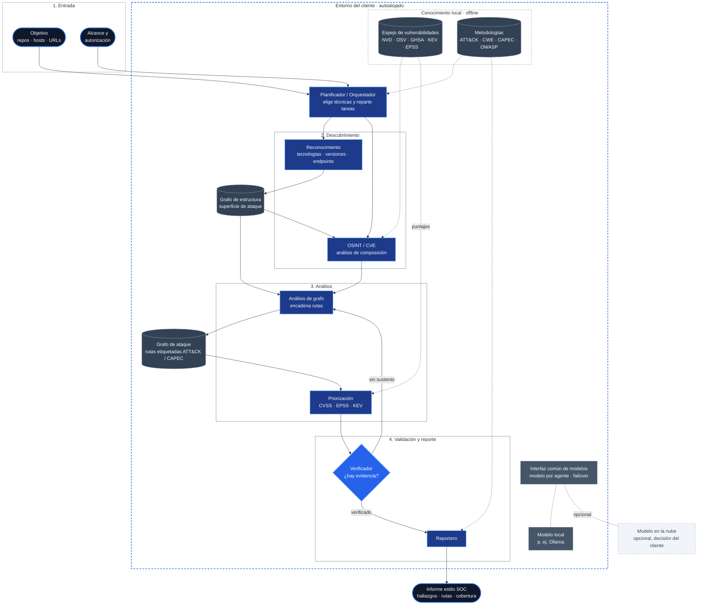

<picture>
  <source media="(prefers-color-scheme: dark)" srcset="assets/logo-dark.svg">
  <source media="(prefers-color-scheme: light)" srcset="assets/logo-light.svg">
  
</picture>

 
 

**Self-hosted vulnerability assessment, powered by specialized AI agents.**
 
Evaluación de vulnerabilidades autoalojada, impulsada por agentes de IA especializados.

 

[English](#what-is-pim) ·
[Español](#qué-es-pim) ·
[Arquitectura](#arquitectura-multiagente) ·
[Metodologías](#metodologías) ·
[Hoja de ruta](#hoja-de-ruta) ·
[Uso responsable](#uso-responsable)

---

## What is PiM

**PiM (Potential-vulnerability Intelligence Mapper)** is a platform that an
organization installs on its own infrastructure to **assess the potential
vulnerabilities** of its systems and software projects.

A team of AI agents, each with a narrowly scoped task, analyzes the structure of
the target, cross-references it with known vulnerability databases, builds the
possible attack paths, and produces a **SOC-style report** in which every
finding is mapped to a standard methodology (MITRE ATT&CK, CWE/CAPEC or OWASP).

> [!IMPORTANT]
> PiM performs **vulnerability assessment**, not penetration testing. It does
> not run exploits, it does not modify systems, and it does not send data
> outside your environment unless you configure it to.

**Key ideas**

- **Passive by design**: read and report only, never attack.
- **100% self-hosted**: vulnerability databases mirrored locally; fully local AI is an option.
- **Two graphs**: a structure graph (the attack surface) and an attack graph (chained attack paths).
- **Evidence-backed findings**: a verifier agent filters out unsupported results.
- **Measured coverage**: the report shows which techniques were reviewed and which were not.

> The rest of this document is in Spanish. / El resto del documento está en español.

---

## Qué es PiM

**PiM (Potential-vulnerability Intelligence Mapper)** es una plataforma que una
organización instala en su propia infraestructura para **evaluar las
vulnerabilidades potenciales** de sus sistemas y proyectos de software.

Un equipo de agentes de IA, cada uno con una tarea acotada, analiza la estructura
del objetivo, la cruza con bases de vulnerabilidades conocidas, construye las
posibles rutas de ataque y genera un **informe estilo SOC** en el que cada
hallazgo queda mapeado a una metodología estándar (MITRE ATT&CK, CWE/CAPEC u
OWASP).

> [!IMPORTANT]
> PiM hace **evaluación de vulnerabilidades**, no *penetration testing*. No
> ejecuta exploits, no modifica sistemas y no envía datos fuera de tu entorno
> salvo que tú lo configures.

### ¿Por qué PiM?

| Problema | Cómo lo aborda PiM |
|---|---|
| El pentesting manual es caro y lento | Automatiza el reconocimiento, el cruce con CVEs y la priorización |
| Las herramientas ofensivas ejecutan exploits reales (riesgo legal y operativo) | Solo lee y reporta: análisis **pasivo** |
| Subir tu mapa de vulnerabilidades a una nube de terceros es inaceptable | **100 % autoalojado**, con bases de vulnerabilidades en espejo local e IA local opcional |
| Los reportes automáticos no dicen qué quedó sin revisar | Mide la **cobertura** contra la metodología: qué se revisó y qué no |

---

## Principios

- **Solo analiza y reporta.** Nunca ataca, explota ni modifica el objetivo.
- **Tus datos no salen.** Bases de vulnerabilidades consultadas offline; el único
  dato que puede salir es el que tú decidas enviar a un modelo en la nube.
- **Fuentes estructuradas, nunca búsqueda web libre.** Los CVE vienen de bases
  oficiales, no de un modelo que puede inventarlos.
- **Cada hallazgo con sustento.** Un agente verificador revisa la evidencia antes
  de que algo llegue al informe.
- **Sin dependencia de proveedor.** El modelo de IA es una pieza intercambiable.

---

## Arquitectura multiagente

Ningún agente analiza todo: cada uno trabaja con un contexto enfocado, lo que
reduce la sobrecarga y los errores.

Línea continua: flujo de trabajo · línea punteada: consulta de datos o conexión opcional · el borde azul punteado marca lo que nunca sale del entorno del cliente.

| Agente | Responsabilidad |
|---|---|
| **Planificador / Orquestador** | Traduce el objetivo en técnicas a revisar y reparte el trabajo |
| **Reconocimiento** | Identifica tecnologías, versiones, dependencias y puntos de entrada; construye el grafo de estructura |
| **OSINT / CVE** | Cruza cada tecnología y versión con las bases de vulnerabilidades (análisis de composición de software) |
| **Análisis de grafo** | Combina estructura y vulnerabilidades para construir el grafo de ataque |
| **Priorización** | Ordena los hallazgos según CVSS, EPSS y CISA KEV |
| **Verificador** | Confirma que cada hallazgo tenga sustento y reduce falsos positivos |
| **Reportero** | Genera el informe estilo SOC mapeado a la metodología |

### Los dos grafos

| | Grafo de estructura | Grafo de ataque |
|---|---|---|
| **Responde a** | ¿Cómo está construido? | ¿Cómo se movería un atacante? |
| **Nodos** | Componentes, servicios, dependencias, endpoints | Estados que gana el atacante (acceso, privilegios) |
| **Aristas** | Quién se comunica con quién | Acciones entre estados, etiquetadas con su técnica (ATT&CK / CAPEC) |
| **Resultado** | Superficie de ataque | Rutas de ataque encadenadas |

El grafo de estructura se construye primero; el de ataque se construye encima de él.

---

## Metodologías

| Objetivo evaluado | Metodología |
|---|---|
| Comportamiento de ataque en un entorno o sistema | [MITRE ATT&CK](https://attack.mitre.org) |
| Explicación lineal para audiencias no técnicas | Cyber Kill Chain |
| Fallos en un software específico | [CWE](https://cwe.mitre.org) + [CAPEC](https://capec.mitre.org) |
| Aplicaciones web | [OWASP](https://owasp.org) Testing Guide / Top 10 |

Cada hallazgo y cada ruta de ataque se etiqueta con su técnica, y el informe
muestra la **cobertura** de la evaluación.

---

## Fuentes de vulnerabilidades

Todas se descargan y se consultan **en espejo local**, para que nada sobre tu
stack salga a internet.

| Fuente | Uso |
|---|---|
| [NVD / CVE](https://nvd.nist.gov) | Base de referencia |
| [OSV.dev](https://osv.dev) | Búsqueda por paquete y versión exactos |
| GitHub Security Advisories | Dependencias de código |
| CISA KEV | Vulnerabilidades explotadas activamente |
| [EPSS](https://www.first.org/epss) + CVSS | Probabilidad de explotación y severidad |

> [!NOTE]
> El emparejamiento versión ↔ CVE genera falsos positivos de forma natural.
> Reducirlos (verificador + evidencia por hallazgo) es parte central del proyecto.

---

## Modelos de IA

PiM se comunica con los modelos a través de una **interfaz común**; cada
organización conecta el que prefiera al desplegar.

| Modo | Ventaja | Contrapartida |
|---|---|---|
| **Nube** (clave propia de Anthropic, OpenAI, etc.) | Mejor razonamiento | Los datos viajan a un tercero |
| **Local** (p. ej. Ollama) | Nada sale del entorno | Requiere hardware; menor calidad |
| **Híbrido** | Razonamiento pesado en la nube con datos abstraídos | Protege menos de lo que parece; no apto para entornos muy sensibles |

Para compensar modelos locales más débiles:

- **Modelo por agente:** el más potente en el planificador y el verificador; uno ligero en los agentes recolectores.
- **Failover y rotación:** lista ordenada de modelos de respaldo ante fallos o límites.
- **Requisitos documentados:** modelos locales recomendados y el hardware que necesitan.

---

## Informe final

- Hallazgos clasificados por técnica de la metodología.
- Evidencia y puntuación de cada hallazgo (CVSS / EPSS / KEV).
- Rutas de ataque visualizadas sobre el grafo.
- Cobertura: tácticas y técnicas revisadas y no revisadas.

---

## Despliegue y seguridad

- Autoalojado en el entorno de la organización.
- Interfaz enlazada solo a `localhost` por defecto.
- Claves y secretos cifrados en reposo; la llave de cifrado se respalda por separado.

---

## Hoja de ruta

PiM está en **fase de diseño**. Aún no hay instrucciones de instalación.

- [ ] Definir el enfoque: caja blanca (con código fuente) o caja negra
- [ ] Definir la metodología principal según el tipo de objetivo
- [ ] Elegir lenguaje y stack de implementación
- [ ] Definir el modelo de licencia
- [ ] Montar un entorno de pruebas seguro (DVWA, OWASP Juice Shop)
- [ ] Prototipo del agente de reconocimiento y del grafo de estructura
- [ ] Espejo local de NVD / OSV / KEV / EPSS
- [ ] Primer informe estilo SOC de extremo a extremo

---

## Uso responsable

PiM es una herramienta **defensiva**, pero solo debe usarse sobre sistemas
propios o con **autorización expresa** de su titular. Analizar sistemas de
terceros sin permiso puede constituir delito (en Perú, Ley N.º 30096 de Delitos
Informáticos, y normativa equivalente en otros países). Los autores no se
responsabilizan por usos no autorizados.

---

## Sobre el nombre

**PiM** significa *Potential-vulnerability Intelligence Mapper*: mapea
vulnerabilidades **potenciales** (no confirmadas por explotación) con ayuda de
agentes de **inteligencia** artificial.

El nombre también tiene un guiño al quechua: *pi* significa "¿quién?", y el
sufijo *-m* marca algo que se afirma con evidencia directa. Son las dos ideas de
la herramienta: preguntarse **quién** podría entrar y **sustentar** cada
hallazgo.

---

## Contribuir

El proyecto está en etapa temprana. Las ideas, la revisión de la arquitectura y
los issues son bienvenidos.

## Licencia

Por definir.

 

 
Hecho en Perú

